<div align="center">

# 🏨 StayEase - Room Booking System

### A Full-Stack MERN Web Application for Hotel Room Reservations

[](https://nodejs.org/)
[](https://react.dev/)
[](https://www.mongodb.com/atlas)
[](https://expressjs.com/)
[](https://vite.dev/)
[](https://tailwindcss.com/)
[](LICENSE)

*A production-grade hotel booking platform enabling guests to discover, browse, and reserve rooms online - with a powerful admin dashboard for managing inventory, bookings, and revenue analytics.*

---

</div>

## 📑 Table of Contents

- [Project Overview](#-project-overview)
- [Key Features](#-key-features)
- [Technology Stack](#-technology-stack)
- [System Architecture](#-system-architecture)
- [Database Schema (ERD)](#-database-schema-erd)
- [API Reference](#-api-reference)
- [Authentication & Security](#-authentication--security)
- [Frontend Architecture](#-frontend-architecture)
- [Component Hierarchy](#-component-hierarchy)
- [State Management](#-state-management)
- [Data Flow](#-data-flow)
- [Project Structure](#-project-structure)
- [Design System](#-design-system)
- [User Roles & Permissions](#-user-roles--permissions)
- [Setup & Installation](#-setup--installation)
- [Environment Variables](#-environment-variables)
- [Database Seeding](#-database-seeding)
- [Key Business Logic](#-key-business-logic)

---

## 🔍 Project Overview

**StayEase** is a full-stack MERN (MongoDB, Express, React, Node.js) web application that provides a seamless room booking experience for travelers while giving hotel administrators a centralized dashboard to manage operations. The system follows a **3-Tier Architecture** pattern separating Presentation, Application, and Data layers for clean modularity and scalability.

### Problem Statement

Hotels need a digital platform to:
- Showcase their room inventory with rich media (images, descriptions, amenities)
- Allow guests to search, filter, and book rooms with date-based availability checking
- Provide administrators with booking management, room CRUD, and revenue analytics

### Solution

StayEase addresses these needs through a **decoupled client-server architecture** with:
- A responsive React SPA for the guest-facing experience
- A RESTful Express.js API with JWT-authenticated endpoints
- MongoDB Atlas for flexible, document-based data persistence
- Cloudinary CDN for optimized room image delivery

---

## ✨ Key Features

### 🧑‍💼 Guest Features
| Feature | Description |
|---|---|
| **Room Browsing** | Browse all available rooms with filtering by type, capacity, and price |
| **Room Search** | Search with check-in/check-out dates, guest count, and room type |
| **Room Details** | View room gallery, amenities, ratings, and detailed descriptions |
| **Online Booking** | Select dates, view price calculation, and reserve rooms |
| **Booking History** | View all past and upcoming bookings with status tracking |
| **Profile Management** | Update name, avatar, and account settings |
| **Review System** | Rate and review rooms after completing a stay |

### 🛡️ Admin Features
| Feature | Description |
|---|---|
| **Dashboard Analytics** | View daily bookings, monthly revenue, occupancy rate, and user count |
| **Room Management** | Full CRUD operations on room inventory |
| **Image Management** | Upload up to 5 images per room via Cloudinary CDN |
| **Booking Management** | View, confirm, cancel, and update booking statuses |
| **Review Moderation** | Delete inappropriate reviews |

---

## 🛠 Technology Stack

### Complete Dependency Map

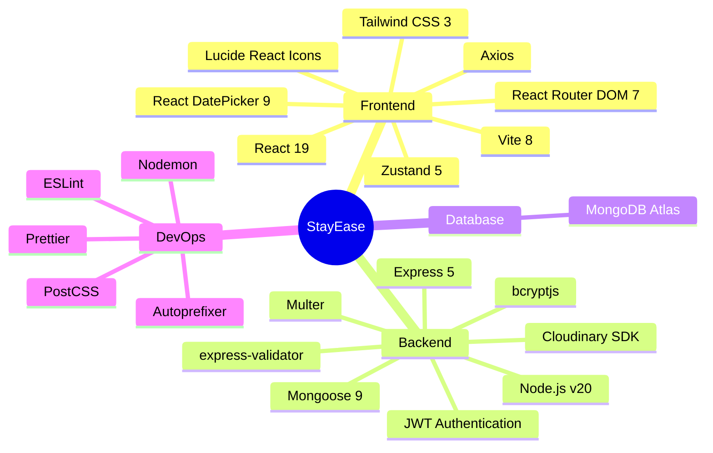

### Stack Breakdown

| Layer | Technology | Version | Purpose |
|---|---|---|---|
| **Runtime** | Node.js | v20+ | Server-side JavaScript runtime |
| **Frontend Framework** | React | 19.2.6 | Component-based UI library |
| **Build Tool** | Vite | 8.0.12 | Lightning-fast HMR & bundling |
| **Styling** | Tailwind CSS | 3.4.19 | Utility-first CSS framework |
| **State Management** | Zustand | 5.0.14 | Lightweight global state |
| **HTTP Client** | Axios | 1.17.0 | Promise-based API calls with interceptors |
| **Routing** | React Router DOM | 7.17.0 | Declarative client-side routing |
| **Icons** | Lucide React | 1.18.0 | Modern icon library |
| **Date Picker** | react-datepicker | 9.1.0 | Calendar-based date selection |
| **Backend Framework** | Express.js | 5.2.1 | Minimal web framework for APIs |
| **ODM** | Mongoose | 9.7.0 | MongoDB object modeling |
| **Authentication** | jsonwebtoken | 9.0.3 | JWT token creation & verification |
| **Password Hashing** | bcryptjs | 3.0.3 | Secure password hashing (salt rounds: 10) |
| **File Upload** | Multer | 2.1.1 | Multipart form data handling |
| **Image CDN** | Cloudinary | 2.10.0 | Cloud-based image storage & optimization |
| **Validation** | express-validator | 7.3.2 | Request validation middleware |
| **Stream Utility** | streamifier | 0.1.1 | Buffer-to-stream conversion for uploads |
| **Typography** | Inter (Google Fonts) | - | Modern sans-serif font family |

---

## 🏗 System Architecture

### 3-Tier Architecture Overview

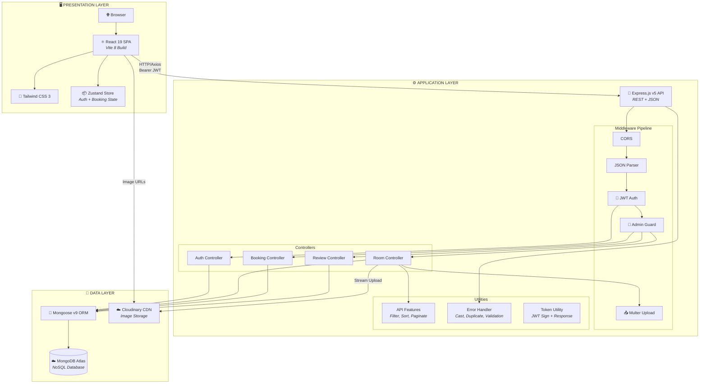

### Request-Response Lifecycle

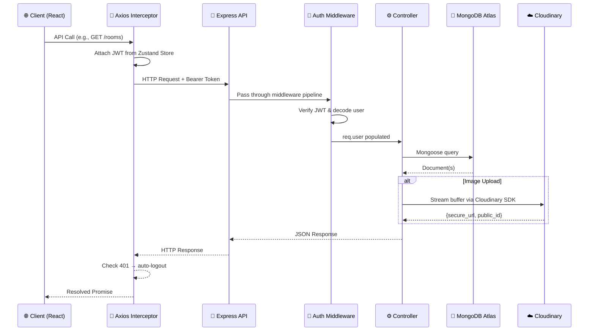

---

## 📊 Database Schema (ERD)

### Entity Relationship Diagram

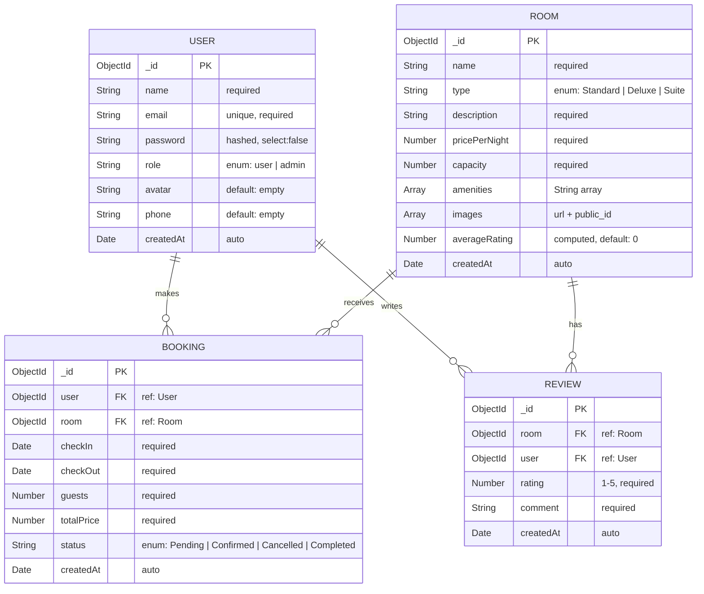

### Schema Constraints & Business Rules

| Model | Constraint | Implementation |
|---|---|---|
| **User** | Unique email | `unique: true` index |
| **User** | Password hidden | `select: false` - excluded from queries |
| **User** | Auto-hash password | `pre('save')` hook → bcrypt (10 salt rounds) |
| **Room** | Type validation | `enum: ['Standard', 'Deluxe', 'Suite']` |
| **Booking** | Status workflow | `enum: ['Pending', 'Confirmed', 'Cancelled', 'Completed']` |
| **Review** | One per user per room | Compound unique index `{room: 1, user: 1}` |
| **Review** | Auto-updates room rating | `post('save')` and `pre('remove')` hooks trigger aggregation |

---

## 📡 API Reference

### Base URL: `/api/v1`

### Authentication Endpoints

| Method | Endpoint | Auth | Description |
|---|---|---|---|
| `POST` | `/auth/register` | ❌ | Register new user |
| `POST` | `/auth/login` | ❌ | Login & receive JWT |
| `GET` | `/auth/me` | 🔐 | Get current user profile |
| `PUT` | `/auth/me` | 🔐 | Update name & phone |
| `PUT` | `/auth/change-password` | 🔐 | Change password |

### Room Endpoints

| Method | Endpoint | Auth | Description |
|---|---|---|---|
| `GET` | `/rooms` | ❌ | Get all rooms (filter, sort, paginate) |
| `GET` | `/rooms/:id` | ❌ | Get single room details |
| `GET` | `/rooms/available` | ❌ | Check room availability by dates |
| `POST` | `/rooms` | 👑 Admin | Create new room |
| `PUT` | `/rooms/:id` | 👑 Admin | Update room details |
| `DELETE` | `/rooms/:id` | 👑 Admin | Delete room |
| `POST` | `/rooms/:id/images` | 👑 Admin | Upload images (max 5 files, 5MB each) |
| `DELETE` | `/rooms/:id/images/:imgId` | 👑 Admin | Delete specific image |

### Booking Endpoints

| Method | Endpoint | Auth | Description |
|---|---|---|---|
| `POST` | `/bookings` | 🔐 | Create booking (with overlap check) |
| `GET` | `/bookings/my` | 🔐 | Get current user's bookings |
| `GET` | `/bookings/:id` | 🔐 | Get booking details |
| `PATCH` | `/bookings/:id/cancel` | 🔐 | Cancel booking (owner or admin) |
| `GET` | `/bookings` | 👑 Admin | Get all bookings |
| `PATCH` | `/bookings/:id/status` | 👑 Admin | Update booking status |

### Review Endpoints

| Method | Endpoint | Auth | Description |
|---|---|---|---|
| `GET` | `/rooms/:roomId/reviews` | ❌ | Get all reviews for a room |
| `POST` | `/rooms/:roomId/reviews` | 🔐 | Create review (must have completed stay) |
| `DELETE` | `/rooms/:roomId/reviews/:reviewId` | 👑 Admin | Delete review |

> **Legend:** ❌ = Public &nbsp;|&nbsp; 🔐 = Authenticated User &nbsp;|&nbsp; 👑 = Admin Only

### API Features (Query Parameters)

The `GET /rooms` endpoint supports advanced query features via the `APIFeatures` utility class:

| Feature | Parameter | Example |
|---|---|---|
| **Filtering** | Any field name | `?type=Deluxe&capacity=2` |
| **Comparison** | `gte`, `gt`, `lte`, `lt` | `?pricePerNight[lte]=200` |
| **Sorting** | `sort` | `?sort=-pricePerNight,averageRating` |
| **Pagination** | `page`, `limit` | `?page=2&limit=10` |

---

## 🔐 Authentication & Security

### Authentication Flow

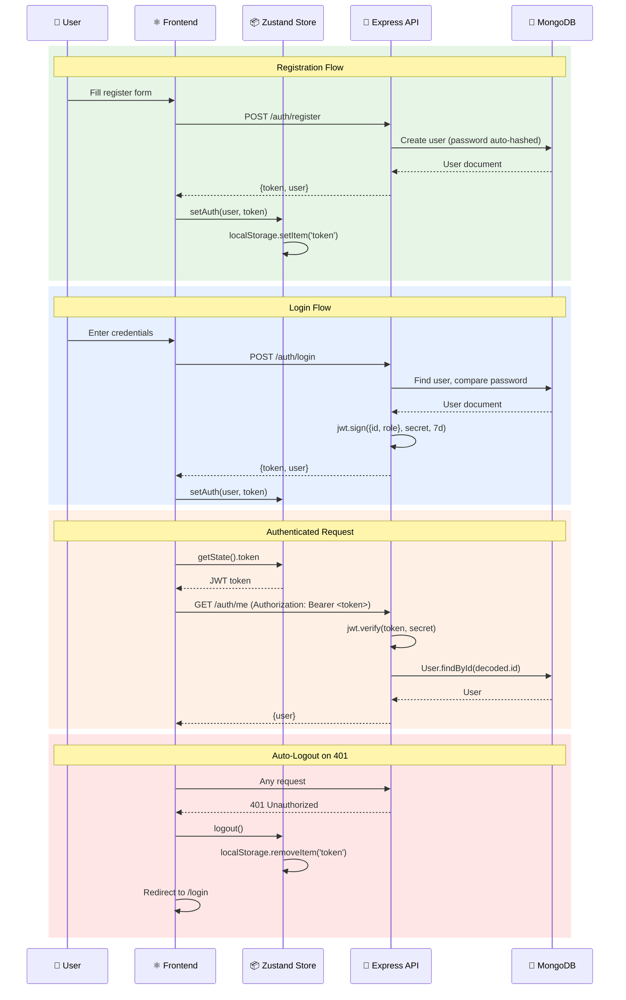

### Security Measures

| Layer | Measure | Implementation |
|---|---|---|
| **Password Storage** | bcrypt hashing | 10 salt rounds, `pre('save')` hook |
| **Password Exposure** | Field exclusion | `select: false` on password field |
| **Token Security** | JWT with expiry | 7-day expiration, signed with `JWT_SECRET` |
| **Route Protection** | Middleware guards | `protect` (auth) + `adminOnly` (role) |
| **Input Validation** | Express Validator | Request body validation middleware |
| **File Uploads** | Multer validation | Image-only filter, 5MB size limit |
| **CORS** | Cross-Origin | `cors()` middleware enabled |
| **Error Handling** | Centralized handler | Catches CastError, 11000, ValidationError |
| **Auto-Logout** | Axios interceptor | 401 response → clear state → redirect |

---

## ⚛️ Frontend Architecture

### Client-Side Architecture Diagram

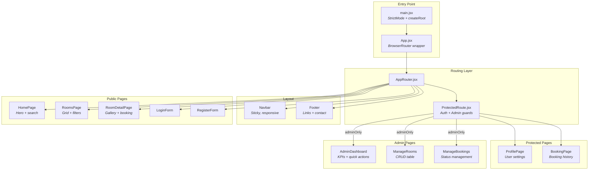

### Client-Side Routing Map

| Path | Component | Auth | Description |
|---|---|---|---|
| `/` | `HomePage` | ❌ | Landing page with hero + search |
| `/rooms` | `RoomsPage` | ❌ | Room listing with filters |
| `/rooms/:id` | `RoomDetailPage` | ❌ | Room detail with gallery + booking form |
| `/login` | `LoginForm` | ❌ | User login |
| `/register` | `RegisterForm` | ❌ | User registration |
| `/profile` | `ProfilePage` | 🔐 | User profile management |
| `/bookings` | `BookingPage` | 🔐 | User's booking history |
| `/admin/dashboard` | `AdminDashboard` | 👑 | Admin analytics dashboard |
| `/admin/rooms` | `ManageRooms` | 👑 | Room CRUD management |
| `/admin/bookings` | `ManageBookings` | 👑 | Booking status management |

---

## 🧩 Component Hierarchy

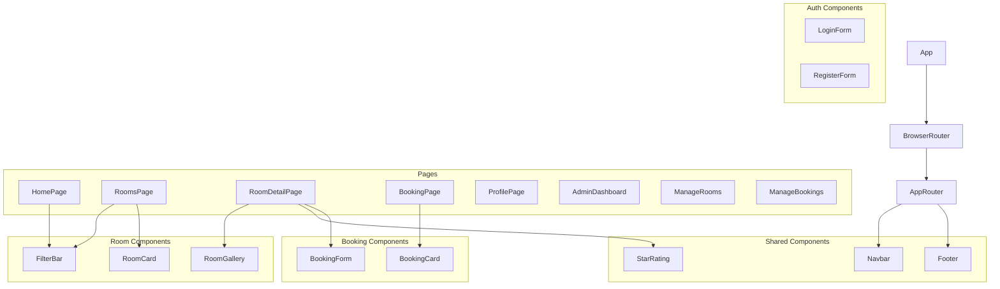

### Component Inventory

| Category | Component | Props | Purpose |
|---|---|---|---|
| **Shared** | `Navbar` | - | Sticky navigation with auth-aware links |
| **Shared** | `Footer` | - | Site footer with quick links & contact |
| **Shared** | `StarRating` | `rating`, `maxRating`, `onRatingChange`, `readOnly` | Reusable 5-star rating display/input |
| **Auth** | `LoginForm` | - | Email/password login with validation |
| **Auth** | `RegisterForm` | - | Registration with password confirmation |
| **Rooms** | `FilterBar` | `onSearch` | Search form: dates, guests, room type |
| **Rooms** | `RoomCard` | `room` | Room preview card with image, price, rating |
| **Rooms** | `RoomGallery` | `images` | Image carousel with navigation |
| **Bookings** | `BookingForm` | `room` | Date selection, price calculation, reserve |
| **Bookings** | `BookingCard` | `booking`, `onCancel` | Booking details with status badge + cancel |

---

## 📦 State Management

### Zustand Store Architecture

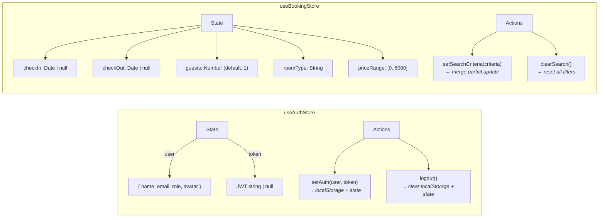

### State Persistence

| Store | Persistence | Method |
|---|---|---|
| `useAuthStore` | ✅ Token persisted | `localStorage.getItem/setItem('token')` |
| `useAuthStore` | ❌ User not persisted | Re-fetched via `GET /auth/me` on app load |
| `useBookingStore` | ❌ Ephemeral | Cleared on page refresh |

---

## 🔄 Data Flow

### Booking Creation Flow

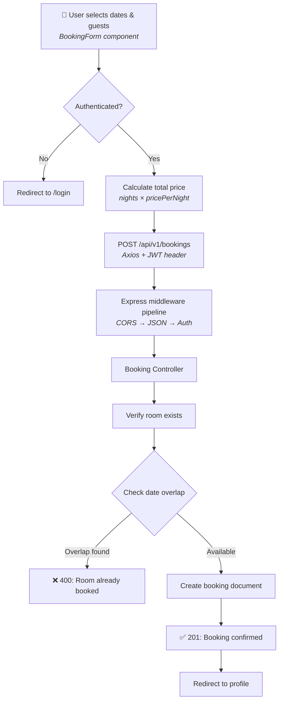

### Review & Rating Flow

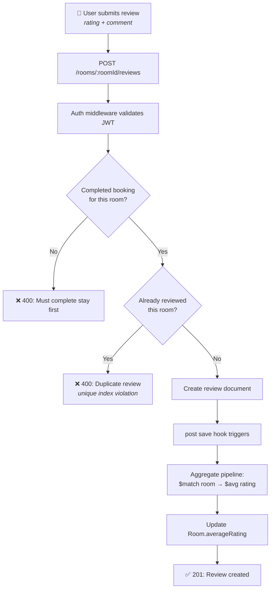

### Image Upload Pipeline

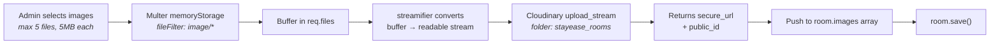

---

## 📁 Project Structure

```
Room Booking System/
│
├── 📄 README.md                          # Original README
├── 📄 PROJECT_REPORT.md                  # This comprehensive report
├── 📄 .gitignore                         # Git ignore rules
│
├── 📂 server/                            # ── BACKEND ──────────────────
│   ├── 📄 package.json                   # Server dependencies
│   ├── 📄 .env                           # Environment variables (git-ignored)
│   │
│   └── 📂 src/
│       ├── 📄 server.js                  # Entry point: dotenv, DB connect, listen
│       ├── 📄 app.js                     # Express app: middleware, routes, error handler
│       │
│       ├── 📂 config/
│       │   ├── 📄 db.js                  # MongoDB Atlas connection via Mongoose
│       │   └── 📄 cloudinary.js          # Cloudinary v2 SDK configuration
│       │
│       ├── 📂 models/
│       │   ├── 📄 User.model.js          # User schema + password hashing hooks
│       │   ├── 📄 Room.model.js          # Room schema with images subdocument
│       │   ├── 📄 Booking.model.js       # Booking schema with status enum
│       │   └── 📄 Review.model.js        # Review schema + avg rating aggregation
│       │
│       ├── 📂 controllers/
│       │   ├── 📄 auth.controller.js     # Register, login, getMe, updateMe, changePassword
│       │   ├── 📄 room.controller.js     # CRUD + image upload/delete + availability check
│       │   ├── 📄 booking.controller.js  # Create, list, cancel + admin: getAll, updateStatus
│       │   └── 📄 review.controller.js   # Get reviews, create (with booking check), delete
│       │
│       ├── 📂 routes/
│       │   ├── 📄 auth.routes.js         # /api/v1/auth/*
│       │   ├── 📄 room.routes.js         # /api/v1/rooms/* (includes nested review routes)
│       │   ├── 📄 booking.routes.js      # /api/v1/bookings/*
│       │   └── 📄 review.routes.js       # Mounted at /rooms/:roomId/reviews
│       │
│       ├── 📂 middleware/
│       │   ├── 📄 auth.middleware.js      # JWT verification + user population
│       │   ├── 📄 admin.middleware.js     # Role-based access (admin only)
│       │   └── 📄 upload.middleware.js    # Multer config: memoryStorage, 5MB limit
│       │
│       └── 📂 utils/
│           ├── 📄 apiFeatures.js         # Query builder: filter, sort, paginate
│           ├── 📄 errorHandler.js        # Global error middleware
│           ├── 📄 sendToken.js           # JWT creation + response helper
│           └── 📄 seeder.js              # Database seeder with sample rooms
│
└── 📂 client/                            # ── FRONTEND ─────────────────
    ├── 📄 package.json                   # Client dependencies
    ├── 📄 index.html                     # HTML entry point
    ├── 📄 vite.config.js                 # Vite + React plugin config
    ├── 📄 tailwind.config.js             # Custom theme: colors, fonts, shadows
    ├── 📄 postcss.config.js              # PostCSS with Tailwind + Autoprefixer
    ├── 📄 eslint.config.js               # ESLint configuration
    ├── 📄 .env                           # VITE_API_URL
    ├── 📄 design_system.md               # Design system documentation
    │
    └── 📂 src/
        ├── 📄 main.jsx                   # React 19 createRoot entry
        ├── 📄 App.jsx                    # BrowserRouter wrapper
        ├── 📄 index.css                  # Tailwind directives + component classes
        ├── 📄 App.css                    # Additional styles (Vite defaults)
        │
        ├── 📂 router/
        │   ├── 📄 AppRouter.jsx          # All route definitions + layout
        │   └── 📄 ProtectedRoute.jsx     # Auth guard + admin-only check
        │
        ├── 📂 store/
        │   ├── 📄 useAuthStore.js        # Zustand: user, token, setAuth, logout
        │   └── 📄 useBookingStore.js     # Zustand: search criteria state
        │
        ├── 📂 services/
        │   ├── 📄 api.js                 # Axios instance + request/response interceptors
        │   ├── 📄 auth.service.js        # login, register, getMe, updateProfile
        │   ├── 📄 room.service.js        # getRooms, getRoomById, createRoom, updateRoom, deleteRoom
        │   ├── 📄 booking.service.js     # createBooking, getMyBookings, cancelBooking, getAllBookings
        │   └── 📄 review.service.js      # createReview
        │
        ├── 📂 components/
        │   ├── 📂 shared/
        │   │   ├── 📄 Navbar.jsx         # Responsive nav with auth-aware menu
        │   │   ├── 📄 Footer.jsx         # 4-column footer layout
        │   │   └── 📄 StarRating.jsx     # Interactive/read-only star rating
        │   ├── 📂 auth/
        │   │   ├── 📄 LoginForm.jsx      # Login form with error handling
        │   │   └── 📄 RegisterForm.jsx   # Register with password confirmation
        │   ├── 📂 rooms/
        │   │   ├── 📄 FilterBar.jsx      # Search: dates, guests, type
        │   │   ├── 📄 RoomCard.jsx       # Room preview card
        │   │   └── 📄 RoomGallery.jsx    # Image carousel with dot navigation
        │   └── 📂 bookings/
        │       ├── 📄 BookingForm.jsx    # Booking: date pick, price calc, reserve
        │       └── 📄 BookingCard.jsx    # Booking history with status badges
        │
        └── 📂 pages/
            ├── 📄 HomePage.jsx           # Hero section + search bar
            ├── 📄 RoomsPage.jsx          # Room grid listing
            ├── 📄 RoomDetailPage.jsx     # Room detail: gallery, amenities, booking
            ├── 📄 BookingPage.jsx        # User's booking list
            ├── 📄 ProfilePage.jsx        # Profile editor
            └── 📂 admin/
                ├── 📄 AdminDashboard.jsx # KPI cards + quick actions
                ├── 📄 ManageRooms.jsx    # Room CRUD table
                └── 📄 ManageBookings.jsx # Booking management table
```

**File Count Summary:**

| Category | Files |
|---|---|
| Server Source Files | 16 |
| Client Source Files | 24 |
| Config & Build Files | 8 |
| **Total Source Files** | **48** |

---

## 🎨 Design System

### Color Palette

| Token | Value | Usage |
|---|---|---|
| `primary` | `#1A3C5E` | Navy blue - headers, buttons, navbar, footer |
| `primary-dark` | `#002645` | Darker navy - button hover states |
| `accent` | `#E8A045` | Warm gold - ratings, highlights, CTAs |
| `surface` | `#F8F7F4` | Off-white - page background |
| `surface-elevated` | `#FFFFFF` | White - cards, modals |
| Text Primary | `#1B1B1D` | Near-black - body text |
| Text Secondary | `#43474E` | Dark gray - descriptions |
| Text Muted | `#A9C9F2` | Light blue - footer text |

### Typography

| Property | Value |
|---|---|
| Font Family | `Inter` (Google Fonts) |
| Weights Used | 400 (Regular), 500 (Medium), 600 (Semibold), 700 (Bold) |
| Rendering | `antialiased` |

### Elevation & Shadows

| Level | Shadow | Usage |
|---|---|---|
| `level-1` | `0px 2px 8px rgba(0,0,0,0.07)` | Cards, navbar |
| `level-2` | `0px 4px 16px rgba(0,0,0,0.1)` | Modals, dropdowns |
| `level-hover` | `0px 8px 24px rgba(0,0,0,0.1)` | Card hover state |

### Reusable CSS Components

```css
.btn-primary   → Navy background, white text, rounded-lg, hover:darker
.btn-secondary → White background, navy border, rounded-lg, hover:gray-50
.card          → White background, rounded-card (10px), shadow-level-1, hover:shadow-level-hover
.input-field   → Full width, gray border, rounded-lg, focus:navy ring
```

---

## 👥 User Roles & Permissions

### Permission Matrix

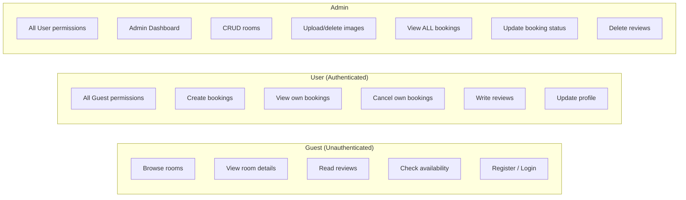

| Action | Guest | User | Admin |
|---|:---:|:---:|:---:|
| Browse rooms | ✅ | ✅ | ✅ |
| View room details | ✅ | ✅ | ✅ |
| Read reviews | ✅ | ✅ | ✅ |
| Check availability | ✅ | ✅ | ✅ |
| Create bookings | ❌ | ✅ | ✅ |
| View own bookings | ❌ | ✅ | ✅ |
| Cancel own bookings | ❌ | ✅ | ✅ |
| Write reviews | ❌ | ✅ | ✅ |
| Update profile | ❌ | ✅ | ✅ |
| Admin dashboard | ❌ | ❌ | ✅ |
| Create/Edit/Delete rooms | ❌ | ❌ | ✅ |
| Upload/Delete images | ❌ | ❌ | ✅ |
| View all bookings | ❌ | ❌ | ✅ |
| Update any booking status | ❌ | ❌ | ✅ |
| Delete reviews | ❌ | ❌ | ✅ |

---

## 🚀 Setup & Installation

### Prerequisites

| Requirement | Version | Purpose |
|---|---|---|
| Node.js | v20+ | Runtime environment |
| npm | v9+ | Package manager |
| MongoDB Atlas | Free M0 | Cloud database |
| Cloudinary Account | Free tier | Image CDN |

### Installation Steps

```bash
# 1. Clone the repository
git clone https://github.com/Senthuran-dev/Room-Booking-System.git
cd Room-Booking-System

# 2. Install server dependencies
cd server
npm install

# 3. Install client dependencies
cd ../client
npm install

# 4. Configure environment variables (see section below)

# 5. Start the backend (from /server)
npm run dev          # Uses nodemon for hot-reload

# 6. Start the frontend (from /client)
npm run dev          # Vite dev server with HMR

# 7. (Optional) Seed the database
cd server
node src/utils/seeder.js        # Import sample rooms
node src/utils/seeder.js -d     # Destroy all rooms
```

---

## 🔑 Environment Variables

### Server (`/server/.env`)

| Variable | Required | Description |
|---|:---:|---|
| `MONGODB_URI` | ✅ | MongoDB Atlas connection string |
| `JWT_SECRET` | ✅ | Secret key for signing JWT tokens |
| `CLOUDINARY_CLOUD_NAME` | ✅ | Cloudinary account cloud name |
| `CLOUDINARY_API_KEY` | ✅ | Cloudinary API key |
| `CLOUDINARY_API_SECRET` | ✅ | Cloudinary API secret |
| `PORT` | ❌ | Server port (default: `5000`) |

### Client (`/client/.env`)

| Variable | Required | Description |
|---|:---:|---|
| `VITE_API_URL` | ❌ | API base URL (default: `http://localhost:5000/api/v1`) |

---

## 🌱 Database Seeding

The seeder script (`server/src/utils/seeder.js`) populates the database with **3 sample rooms**:

| Room | Type | Price/Night | Capacity | Rating |
|---|---|---|---|---|
| Ocean View Suite | Suite | $299 | 2 | 4.8 |
| Deluxe City Room | Deluxe | $150 | 3 | 4.5 |
| Standard Twin Room | Standard | $99 | 2 | 4.2 |

Each room includes Unsplash sample images and amenities like WiFi, Balcony, Room Service, etc.

---

## ⚙️ Key Business Logic

### 1. Booking Overlap Detection

The system prevents double-bookings by querying for overlapping date ranges:

```javascript
// Overlap detection query
Booking.find({
  room: roomId,
  status: { $in: ['Pending', 'Confirmed'] },
  $or: [
    { checkIn: { $lt: checkOut }, checkOut: { $gt: checkIn } }
  ]
});
```

This checks if any existing booking's date range intersects with the requested range. Only `Pending` and `Confirmed` bookings block availability - `Cancelled` and `Completed` are ignored.

### 2. Average Rating Computation

Reviews use Mongoose `post('save')` and `pre('remove')` hooks to automatically recalculate the room's `averageRating` via MongoDB's aggregation pipeline:

```javascript
// Aggregation pipeline
Review.aggregate([
  { $match: { room: roomId } },
  { $group: { _id: '$room', averageRating: { $avg: '$rating' } } }
]);
```

### 3. Review Guard (Completed Stay Requirement)

Users can only review a room if they have a **completed** booking for that room:

```javascript
const completedBooking = await Booking.findOne({
  user: req.user.id,
  room: req.params.roomId,
  status: 'Completed'
});
```

### 4. Cloudinary Stream Upload

Images are uploaded via in-memory buffers (no disk I/O) using `streamifier`:

```javascript
// Buffer → Stream → Cloudinary
const stream = cloudinary.uploader.upload_stream(
  { folder: 'stayease_rooms' },
  (error, result) => resolve({ url: result.secure_url, public_id: result.public_id })
);
streamifier.createReadStream(file.buffer).pipe(stream);
```

---

<div align="center">

### Built with the MERN Stack 🍃⚡⚛️🟢

**MongoDB** · **Express.js** · **React** · **Node.js**

---

*StayEase - Where Every Stay Feels Like Home* 🏨

</div>
