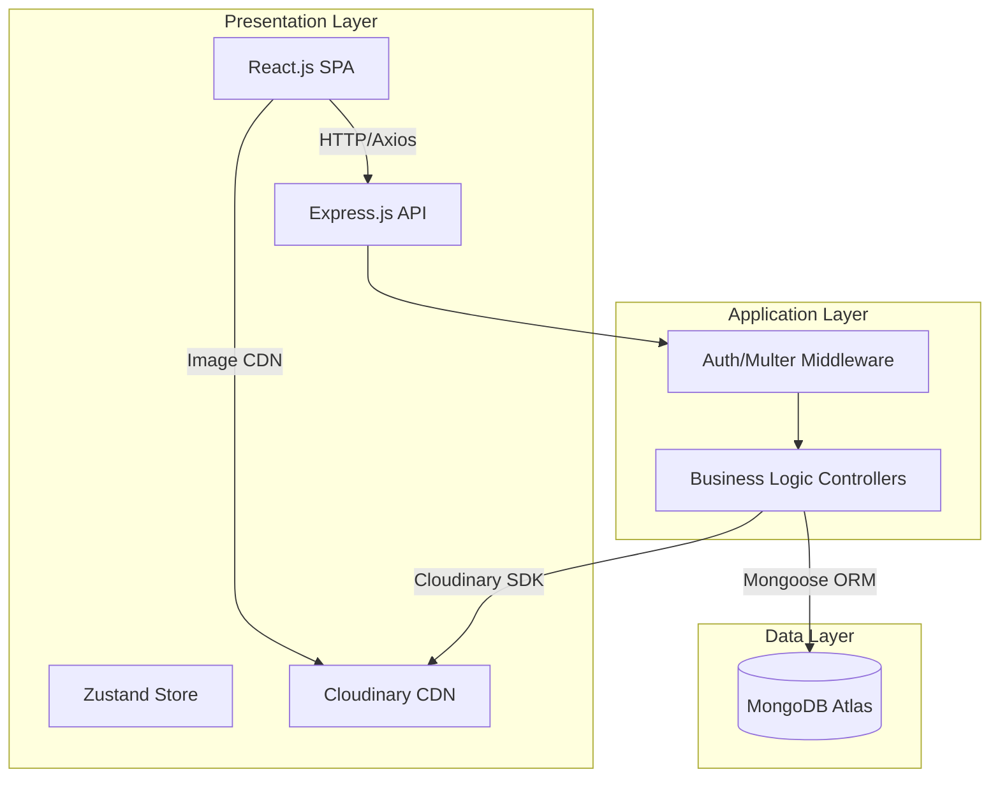

# StayEase Room Booking System

A full-stack MERN web application that enables users to search, browse, and book hotel rooms online. The platform delivers a seamless guest experience for discovering available rooms and completing reservations, while providing hotel administrators with a powerful dashboard for managing inventory, bookings, revenue analytics, and user accounts.

## Tech Stack

- **Presentation Layer:** React.js 19 (Vite 8), Tailwind CSS 3, Zustand 5
- **Application Layer:** Node.js 22.x, Express.js v5, RESTful API
- **Data Layer:** MongoDB Atlas, Mongoose v9 ORM
- **Media Storage:** Cloudinary CDN
- **Auth:** JWT (jsonwebtoken) + bcrypt.js

## 3-Tier System Architecture



## 📁 Project Structure

```text
C:\GITHUB\ROOM BOOKING SYSTEM
├── client (Frontend - React + Vite)
│   ├── src
│   │   ├── assets
│   │   ├── components
│   │   ├── pages
│   │   ├── router
│   │   ├── services
│   │   └── store
│   └── design_system.md
└── server (Backend - Express + MongoDB)
    ├── src
    │   ├── config
    │   ├── controllers
    │   ├── middleware
    │   ├── models
    │   ├── routes
    │   └── utils
    └── .env
```

## 🎨 Design System

The platform utilizes a structured design system focused on **Hospitality Excellence**:
- **Colors**: Deep navy (`#1A3C5E`) for authority and warm amber (`#E8A045`) for accents.
- **Typography**: Inter (Google Fonts) for clean, functional data density.
- **Elevation**: Tonal layers and ambient shadows for depth (Cards use a `0px 2px 8px` shadow).

## Key Features

### Guest Features
- Browse, search, and filter rooms by type, capacity, price, and availability dates with real-time room count and instant filter reset
- View room galleries, detailed descriptions, and full amenities with dedicated Lucide icons
- Book rooms with date selection, price calculation (including 15% tax), and a dedicated confirmation page
- View booking history with status tracking and cancellation
- Rate and review rooms after completing a stay (via review modal)
- Update profile and change password

### Admin Features
- Dashboard with real-time analytics (daily bookings, monthly revenue, occupancy rate, total users)
- Full CRUD room management with Cloudinary image uploads, custom amenity creator, and click-to-zoom image inspection
- Interactive Room Preview Modal with multi-photo carousel, thumbnail navigation, key metrics, and direct live links
- Direct "Browse Live Rooms" navigation link to inspect rooms from the guest perspective
- Booking management with status workflow (Pending → Confirmed → Completed / Cancelled)
- User management (view all users, promote/demote roles, delete accounts)
- Review moderation (delete inappropriate reviews)

### Security & Reliability
- **Concurrency Control:** Utilizes MongoDB transactions and explicit write locks to guarantee zero double-bookings under concurrent load.
- **Security Middleware:** Implements `helmet` for robust HTTP header security, CORS origin restrictions, and `express-rate-limit` to mitigate brute-force and DoS attacks.
- **Render Wake-up:** Free-tier cold-start wake-up strategy implemented via automatic `/health` ping on frontend load.

## Setup Instructions

### Prerequisites
- Node.js 22.x
- MongoDB Atlas free-tier M0 cluster account
- Cloudinary account for media storage

### Environment Variables

**Server** (`/server/.env`):
- `MONGODB_URI` - MongoDB Atlas connection string
- `JWT_SECRET` - Secret key for signing JWT tokens
- `CLOUDINARY_CLOUD_NAME` - Cloudinary cloud name
- `CLOUDINARY_API_KEY` - Cloudinary API key
- `CLOUDINARY_API_SECRET` - Cloudinary API secret
- `PORT` - Server port (default: `5000`)
- `FRONTEND_URL` - Allowed client origin for CORS (default: `http://localhost:5173`)

**Client** (`/client/.env`):
- `VITE_API_URL` - API base URL (default: `http://localhost:5000/api/v1`)

### Installation

1. Navigate to the server folder and install dependencies:
   ```bash
   cd server
   npm install
   ```

2. Navigate to the client folder and install dependencies:
   ```bash
   cd client
   npm install
   ```

3. Start the application:
   - For backend: `npm run dev` in the `/server` directory
   - For frontend: `npm run dev` in the `/client` directory

   The backend root URL (`http://localhost:5000/`) returns an API status response. The detailed health endpoint is available at `http://localhost:5000/api/v1/health`.
