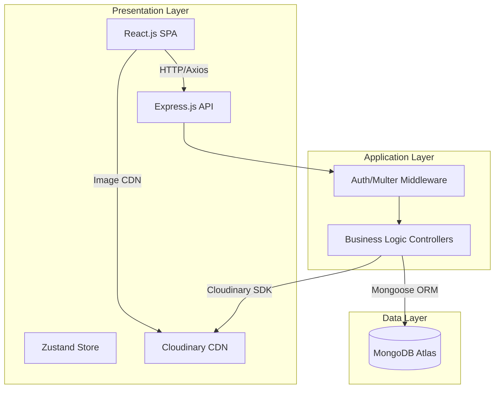

# StayEase Room Booking System

A full-stack MERN web application that enables users to search, browse, and book hotel rooms online. The platform delivers a seamless guest experience for discovering available rooms and completing reservations, while providing hotel administrators with a powerful dashboard for managing inventory, bookings, and revenue analytics.

## Tech Stack

- **Presentation Layer:** React.js 18 (Vite), Tailwind CSS, Zustand
- **Application Layer:** Node.js v20, Express.js v4, RESTful API
- **Data Layer:** MongoDB Atlas, Mongoose v8 ORM
- **Media Storage:** Cloudinary CDN
- **Auth:** JWT (jsonwebtoken) + bcrypt.js

## 3-Tier System Architecture



## Setup Instructions

### Prerequisites
- Node.js v20+
- MongoDB Atlas free-tier M0 cluster account
- Cloudinary account for media storage

### Environment Variables
You will need to create a `.env` file in the root of the `/server` directory and add the following keys once set up:
- `MONGO_URI`
- `JWT_SECRET`
- `CLOUDINARY_CLOUD_NAME`
- `CLOUDINARY_API_KEY`
- `CLOUDINARY_API_SECRET`

### Installation

1. Navigate to the server folder and install dependencies:
   ```bash
   cd server
   npm install
   ```

2. Navigate to the client folder and install dependencies:
   ```bash
   cd client
   npm install
   ```

3. Start the application:
   - For backend: `npm run dev` in the `/server` directory
   - For frontend: `npm run dev` in the `/client` directory
