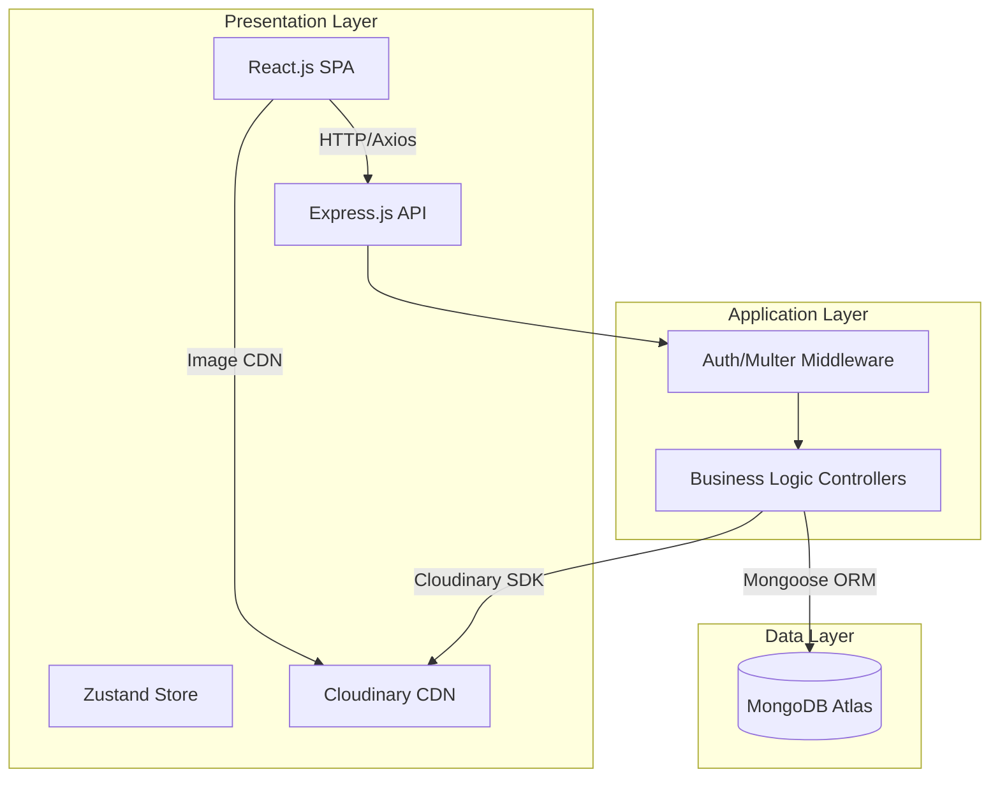

# StayEase Room Booking System

A full-stack MERN web application that enables users to search, browse, and book hotel rooms online. The platform delivers a seamless guest experience for discovering available rooms and completing reservations, while providing hotel administrators with a powerful dashboard for managing inventory, bookings, revenue analytics, and user accounts.

## Tech Stack

- **Presentation Layer:** React.js 19 (Vite 8), Tailwind CSS 3, Zustand 5
- **Application Layer:** Node.js v20, Express.js v5, RESTful API
- **Data Layer:** MongoDB Atlas, Mongoose v9 ORM
- **Media Storage:** Cloudinary CDN
- **Auth:** JWT (jsonwebtoken) + bcrypt.js

## 3-Tier System Architecture



## Key Features

### Guest Features
- Browse, search, and filter rooms by type, capacity, price, and availability dates
- View room galleries, amenities, ratings, and detailed descriptions
- Book rooms with date selection, price calculation (including 15% tax), and a dedicated confirmation page
- View booking history with status tracking and cancellation
- Rate and review rooms after completing a stay (via review modal)
- Update profile and change password

### Admin Features
- Dashboard with real-time analytics (daily bookings, monthly revenue, occupancy rate, total users)
- Full CRUD room management with Cloudinary image uploads
- Booking management with status workflow (Pending → Confirmed → Completed / Cancelled)
- User management (view all users, promote/demote roles, delete accounts)
- Review moderation (delete inappropriate reviews)

## Setup Instructions

### Prerequisites
- Node.js v20+
- MongoDB Atlas free-tier M0 cluster account
- Cloudinary account for media storage

### Environment Variables

**Server** (`/server/.env`):
- `MONGODB_URI` - MongoDB Atlas connection string
- `JWT_SECRET` - Secret key for signing JWT tokens
- `CLOUDINARY_CLOUD_NAME` - Cloudinary cloud name
- `CLOUDINARY_API_KEY` - Cloudinary API key
- `CLOUDINARY_API_SECRET` - Cloudinary API secret
- `PORT` - Server port (default: `5000`)

**Client** (`/client/.env`):
- `VITE_API_URL` - API base URL (default: `http://localhost:5000/api/v1`)

### Installation

1. Navigate to the server folder and install dependencies:
   ```bash
   cd server
   npm install
   ```

2. Navigate to the client folder and install dependencies:
   ```bash
   cd client
   npm install
   ```

3. Start the application:
   - For backend: `npm run dev` in the `/server` directory
   - For frontend: `npm run dev` in the `/client` directory

4. (Optional) Seed the database:
   ```bash
   cd server
   node src/utils/seeder.js        # Import sample rooms
   node src/utils/seeder.js -d     # Destroy all rooms
   ```
